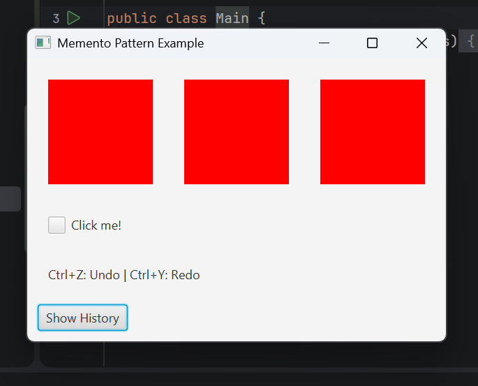

# Memento Pattern – History Functionality

This is my JavaFX assignment for the Memento design pattern.

I used the example project from our course and improved the history functionality.

## What I added

- **Redo (Ctrl+Y):** After undoing a change, I can redo it using Ctrl+Y.
- **History Window:** I added a window that shows saved states with timestamps.
- **Restore State:** I can select a state from the history list and restore it.

The original Undo (Ctrl+Z) functionality is also available.

## Screenshot

## How to run

The project uses Java, JavaFX and Maven.

Open the project in IntelliJ IDEA, let Maven load the dependencies, and run:

`memento.guistate.Main`

## Original project

This assignment is based on the course example:

https://github.com/vesavvo/design_patterns

I worked on the `memento.guistate` package.